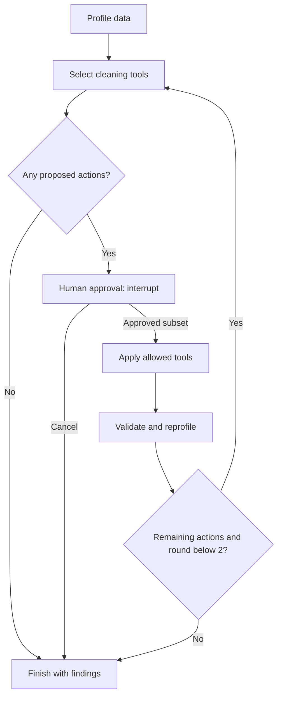

# Data Cleaning Prototype

A runnable **LangGraph data-cleaning agent prototype** for small synthetic or de-identified RWE tables. It profiles a CSV, selects an allowlisted cleaning plan, pauses for human approval, applies selected tools, and validates the result. New findings can trigger a second planning/review pass. Outputs include cleaned data, unresolved findings, original input and a cell-level audit trail.

## Run locally

Requires Python **3.11+**. From the repository root:

```bash
cd "Data Cleaning Prototype"
python3 -m venv .venv
source .venv/bin/activate
python -m pip install -r requirements.txt
python -m streamlit run app.py
```

On Windows, use `python` instead of `python3`, then activate with `.venv\Scripts\activate` in Command Prompt or `.venv\Scripts\Activate.ps1` in PowerShell.

Open **http://127.0.0.1:8501**. The supplied Streamlit configuration binds to loopback and disables usage statistics. Start the app from this folder so that configuration is loaded.

1. Leave **Synthetic RWE sample** and **Offline rules** selected.
2. Click **Profile and propose plan**. This runs the real LangGraph and pauses at `interrupt()` without modifying data.
3. Inspect the proposed tools, columns and affected-cell estimates. Select approved actions. Exact-duplicate removal is deliberately **not selected by default** because identical rows can represent legitimate repeated events.
4. Click **Apply selected actions**. Each subsequent review round requires a separate approval. The graph stops after at most two cleaning rounds.
5. Inspect original/current data, unresolved findings and the audit log.
6. Download **Cleaned CSV**, **Review workbook**, or **Full audit bundle** before clearing the session or restarting.

Offline mode is a deterministic planner and makes no model call. It demonstrates the actual graph, tools, approval and validation behavior; it does not simulate LLM performance.

## Enable LLM planning

Set your own API credentials before starting the server:

```bash
export OPENAI_API_KEY="YOUR_API_KEY"
export OPENAI_MODEL="gpt-4.1-mini"
python -m streamlit run app.py
```

PowerShell:

```powershell
$env:OPENAI_API_KEY="YOUR_API_KEY"
$env:OPENAI_MODEL="gpt-4.1-mini"
python -m streamlit run app.py
```

Choose **OpenAI planner** and confirm sending the profile/contract. `.env.example` documents variables but is **not loaded automatically**. Use a model available to your account that supports strict structured outputs. Credentials stay in server environment variables.

The LLM receives column names, aggregate missing/duplicate counts, the explicit data contract, and candidate tool IDs/reasons/counts. **Patient rows and sample cell values are not included.** Column names and user-written dictionaries may still contain sensitive metadata; use synthetic or appropriately de-identified data. The API call uses `store: false`; provider data handling and billing policies still apply.

The LLM selects candidate action IDs through JSON Schema/Pydantic structured output. Code rejects invented/duplicate action IDs. The model cannot write arbitrary Python, change cleaning parameters or directly edit patient values. The UI lets the reviewer accept a subset of the proposed actions.

## LangGraph architecture



- **StateGraph / TypedDict state:** original/current rows, contract, profile, plan, decisions, findings, trace, API usage and audit.
- **InMemorySaver:** checkpoints the actual graph state by a unique `thread_id`. It supports pause/resume within this process/session; it is **not durable storage**.
- **interrupt / Command(resume=...):** real human approval. No transformations occur before review. The review node is side-effect-free before `interrupt`, so node replay cannot duplicate cleaning.
- **Conditional edges:** skip execution when there is no plan, handle cancellation, and replan newly exposed issues for at most two rounds.
- **Bounded tool selection:** optional LLM chooses among known tools; deterministic Python executes only approved actions.
- **Validation feedback:** outliers, missing values and ambiguous dates remain findings. A finished graph does not certify data fitness for a study.

The app uses direct OpenAI Responses API calls for structured planning and LangGraph for orchestration; no LangChain model adapter, vector database, fine-tuning or multi-agent framework is required.

## Included cleaning tools

| Tool | Approved behavior | Boundary |
|---|---|---|
| `trim` | Remove leading/trailing whitespace | Does not rename headers or alter internal text |
| `normalize_missing` | Convert configured tokens such as NA/N/A/NULL to null | No imputation or row deletion; edit the contract when a token is a valid domain value |
| `normalize_category` | Apply an explicit category mapping | Unknown categories remain unchanged and flagged |
| `normalize_date` | Normalize valid year-first dates to ISO | Ambiguous day/month strings and invalid dates are retained and flagged |
| `normalize_number` | Canonicalize numeric text without rounding | IDs retain leading zeros; invalid numbers remain unchanged; no currency/unit conversion |
| `drop_exact_duplicates` | Keep first row identical across all source columns | Never deduplicate solely by patient ID; requires explicit approval |

Default domain checks flag age outside 0–120, negative total costs, missing required fields, invalid numbers/dates, unmapped categories and discharge before admission. These are **editable demonstration checks**, not validated clinical rules. Implausible values are never automatically corrected, removed, winsorized or imputed. Negative costs can be legitimate adjustments in some datasets: adapt the contract to the study and data source.

## Data contract and sample

The default synthetic table has `patient_id`, `age`, `sex`, `admission_date`, `discharge_date`, and `total_cost`. The UI's **Edit data contract** panel defines required/identifier/numeric/date columns, missing tokens, category maps, plausibility ranges and date-order pairs.

`sample_rwe.csv` has 10 fictional source records with common formatting issues and deliberately unresolved clinical/data problems. Approving all tools yields 8 rows with the supplied contract; leaving duplicate removal unapproved preserves all 10 rows. Repeated patient IDs with different encounters are retained.

To see a second review pass, use two otherwise identical rows whose only difference is leading whitespace, with no initial exact duplicates. First approve trimming; the next profile exposes a duplicate and asks for a new approval. Declined actions remain blocked for that run and are listed as remaining opportunities.

## Provenance and exports

- `__source_row__` is the original 1-based CSV **record number including the header**. With embedded newlines, it is not necessarily a physical file line number.
- Original data stay unchanged in state. Each modified cell records source row, action, column, before/after values and round. Removed duplicates record their full prior row, allowing reconstruction of the original records.
- `Review workbook` contains Original, Cleaned, Issues, Audit, Trace and Metadata sheets. Identifier/value strings are explicitly stored as text, including strings beginning with `=`, for spreadsheet review.
- `Full audit bundle` contains the exact original input CSV, cleaned CSV, and JSON with the contract, original/current rows, changes, findings, declined/remaining opportunities, execution trace, reviewer notes and API usage.
- CSV uses empty cells for nulls; JSON retains the distinction between empty source strings and normalized nulls. CSV strings are preserved verbatim; use the workbook for reviewing untrusted text in a spreadsheet application.
- API latency and elapsed wall time are recorded. Wall time includes waiting and review; it is **not active human labor** and must not be treated as measured time savings or ROI.

## Tests and validation status

```bash
python -m unittest -v
```

**19 tests** cover real LangGraph interrupts, approval/resume, cancellation, a second approval round, subset execution, blocked duplicate removal, reversible audit logs, exact numeric precision, identifier protection, clinical findings, malformed CSV, allowlist rejection, mocked structured API planning, text-safe workbook export, and Streamlit app interactions using `AppTest`.

The graph and offline path were executed with **LangGraph 1.2.19** and **Streamlit 1.66.1**. Live OpenAI connectivity and model plan quality require your configured API key and have not been tested against a real provider in this build. AppTest checks app behavior, not rendered browser appearance. This prototype does not establish production accuracy, efficiency gains, regulatory compliance or ROI.

## Limits

- UTF-8 CSV only; 5 MB, 10,000 data rows, 100 columns, 10,000 characters per cell.
- Two cleaning rounds maximum. Remaining opportunities are exported instead of looping indefinitely.
- In-memory single-user development app; no production authentication, durable checkpoints, database integration or distributed execution.
- Changing sidebar inputs does not alter the current run: start a new run to apply a changed contract or planner.
- Cancellation stops future work. It does not undo earlier approved rounds; download the preserved original if needed.
- Download records before clearing or restarting. No patient data, keys or export files are written to the repository by the app.

## Files

- `app.py` — Streamlit review interface.
- `agent.py` — actual LangGraph, human interrupt, structured planner and conditional loop.
- `cleaning.py` — CSV ingestion, contract checks, deterministic tools and quality checks.
- `exporting.py` — text-safe Excel review workbook.
- `sample_rwe.csv` — fictional development fixture.
- `test_cleaning.py`, `test_app.py` — graph, tool, export and interface tests.
- `requirements.txt`, `.env.example`, `.streamlit/config.toml` — setup.

## Official technical references

- [LangGraph interrupts and resume](https://docs.langchain.com/oss/python/langgraph/interrupts)
- [LangGraph Graph API](https://docs.langchain.com/oss/python/langgraph/graph-api)
- [OpenAI structured outputs](https://developers.openai.com/api/docs/guides/structured-outputs)
