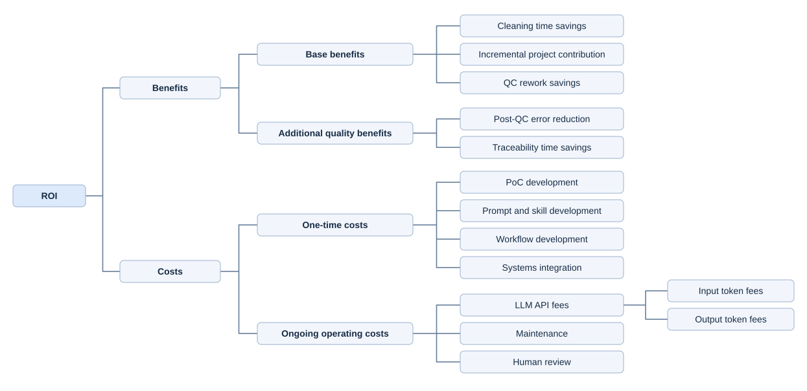

# AI Agent Opportunity Assessment in RWE and HEOR

## 1. Overview 

### Purpose
**AI transformation** is particularly valuable in healthcare workflows that evaluate medicines after approval. Real-world evidence (RWE) teams use routine-care data to study how well medicines work in practice and what they cost. Preparing that evidence often requires **repeated manual work** across datasets, from finding and explaining data quality issues to applying cleaning rules and verifying the results.

This project maps the RWE workflow, identifies and ranks the scenarios most likely to benefit from AI, and connects each priority problem to a specific solution in the built agent. Then it validates an agent for the highest-ranked scenario and estimates the potential return on investment.

### Key finding and proposed solution

After screening candidate scenarios across the RWE workflow, **data cleaning and standardization (W04) ranked first** under the project's default weights. We selected it for the first prototype and built a human-reviewed agent around five recurring problems.

| Pain point | Agent solution |
| --- | --- |
| Slow issue detection - Analysts repeatedly inspect columns and records for missing values, outliers, duplicates, and rule violations. | The agent automatically detects data issues and provides summaries so analysts can focus their review. |
| Long waiting time in collaboration - Analysts and study leads need multiple exchanges to clarify likely causes and agree on next steps. | The agent drafts explanations from the available evidence, with a planned one-click report that would give study leads the likely causes, uncertainties, and proposed actions in one place. |
| Slow rule selection - The appropriate cleaning option depends on the multiple dimensions of studies. | The agent recommends selection based on documented study context and quickly examined data profile, then lets analysts choose and approve the action. |
| Time-consuming missing-value calculations - Analysts repeatedly compute replacement values and resolve cases | The agent applies various replacement methods and calls external tools to calculate via MCP so the calculation can be done in a short time. |
| Slow quality control - QC programmers check errors and mismatching records back-and-forth. | The agent troubleshoots errors consistently, and shows cleaned data and produces traceable reports so reviewers can verify the applied methods and remaining issues. |

### What this means for RWE teams

Imagine RWE analysts are preparing a post-approval analysis of treatment costs and outcomes. The analysts find missing cost values and several repeated records, and they spend a large amount of time dealing with these data issues and additional time preparing the report for review. The agent can deal with data issues and bring findings and proposed actions into one review table, so the analyst can check the affected records, approve only the appropriate changes, and easily get reports for further review, which enhances operational efficiency, increases project capacity, and creates opportunities for revenue growth.

## 2. Project workflow

- [Map the RWE workflow](research/1.%20workflow.md) to identify the tasks, handoffs, and outputs across an RWE study.
- [Identify workflow pain points](research/2.%20rwe_painpoints_with_evidence.md) where manual effort, repetition, coordination, errors, or rework may justify AI assistance.
- [Define candidate use cases](research/5.%20candidate_use_cases.md) by linking workflow problems to tasks an agent could support.
- [Rank and select a scenario](#3-from-opportunity-ranking-to-pilot-selection) using weighted criteria and an interactive sensitivity analysis.
- [Build the prototype](#4-data-cleaning-agent) for data cleaning and standardization, the top-ranked opportunity under the default weights.
- [Validate the prototype](#5-first-round-validation) by checking detection, rule assignment, and execution against expected results on synthetic data.
- [Estimate ROI](#6-first-year-roi-estimate) by valuing potential labor savings and accounting for API, maintenance, and development costs.

## 3. From opportunity ranking to pilot selection

### Weighted Scenario Prioritization and Interactive Sensitivity Analysis

https://github.com/user-attachments/assets/98460b94-aa21-406e-b493-112859994c50

Download the dashboard HTML and open it in a browser to adjust the weights and see how the ranking changes. [Interactive sensitivity dashboard](research/scenario_prioritization.html)

**Default weights**

| Metric | Default weight |
|---|---|
| Potential human-effort savings | 35% |
| Potential error reduction | 25% | 
| Reduction in repetitive labor share | 15% | 
| Task frequency | 15% | 
| Reduction in collaboration burden | 10% |

**Score calculation for each scenario**

- **Labor savings.** Divide estimated hours saved by 320 and multiply by 100.
- **Error reduction.** Divide the decrease in error rate, measured in percentage points, by 5 and multiply by 100.
- **Repetition reduction.** Divide the decrease in repetition level by 4 and multiply by 100.
- **Frequency.** Subtract 1 from the baseline task frequency level, divide by 4, and multiply by 100.
- **Collaboration reduction.** Divide the decrease in collaboration level by 4 and multiply by 100.

The dashboard caps the labor and error dimensions at −100 to 100 and sums each dimension score multiplied by its normalized weight.

#### Default ranking from the current inputs

| Rank | Scenario | Potential hours saved per scoped task | Error reduction (percentage points) | Weighted score |
|---|---|---|---|---|
| 1 | W04: Data cleaning and standardization | 218 | 3 | 56.34 |
| 2 | W01: Research question and protocol design | 220 | 2 | 44.06 |
| 3 | W05: Data quality control | 65 | 2 | 40.86 |
| 4 | W09: Literature screening | 15 | 1 | 14.14 |

W04 was selected for the first prototype because it ranks highest under the default inputs. The ranking is a planning estimate that depends on the assumed effort, error rates, and weights. The methodology describes the underlying task scopes and rating scales. [Full prioritization analysis](research/3.%20compare%20significance%20and%20prioritize%20scenario.md)

## 4. Data cleaning agent

The prototype profiles CSV inputs for missing values, outliers, duplicate candidates, and rule violations. It proposes treatments in a review table, lets analysts choose an action for each issue, and applies supported changes after approval. Analysts can compare the original and cleaned data, export the cleaned CSV, and download a management report.

**Technology stack**

- **GPT-6.1 Sol through the OpenAI Responses API** generates issue explanations and treatment recommendations from study context and aggregate findings.
- **LangGraph** coordinates profiling, planning, human approval, execution, and validation.
- **Skill authoring** codifies cleaning rules, treatment eligibility, and approval requirements in a reusable [data cleaning skill](Data%20Cleaning%20Prototype/SKILL.md).
- **Prompt engineering with edge cases** guides recommendations for cases such as missingness at the 5% threshold, tied modes, and legitimate repeated ZIP codes, with instructions to explain uncertainty and defer methods when evidence is insufficient.
- **Pydantic** validates the structure of model recommendations before the app displays them for review.
- **Python and pandas** support rule-based data checks, approved transformations, and quality summaries.
- **Streamlit** provides the analyst interface, editable review table, and approval controls.
- **openpyxl** generates Excel review workbooks with treatment dropdowns.

[Prototype setup and usage](Data%20Cleaning%20Prototype/README.md)

## 5. First-round validation

We checked all 100 rows in a controlled fixture against issue locations and types specified during fixture construction. The unit of comparison was column or whole-row scope × issue type × source row. A row could trigger multiple checks. Both members of the duplicate group counted as candidates. Repeated ZIP codes were expected and permitted.

| Metric | Result | What was checked |
| --- | --- | --- |
| Detection precision | 47/47 (100%) | 40 missing cells, one IQR outlier, one range violation, one date-order violation, two repeated identifier candidates, and two exact duplicate candidates. The outlier and range violation came from the same value. |
| Detection recall | 47/47 (100%) | All seeded findings were detected, with zero false positives and zero false negatives. Permitted ZIP code repetitions were unflagged. |
| Missingness rule assignment | 4/4 (100%) | 4% missing in a noncritical column → M1, 5% in a critical column → M2, 10% → M3, and 21% → M4. |
| LLM recommendation accuracy | Unmeasured | No live model call was made. The quality of explanations and recommendations and the rate of human overrides remain unmeasured. |
| Calculation and execution accuracy | 5/5 (100%) | The approved median fill produced the independently expected value of 53 in all five cells. The full output and audit matched expectations. |
| Output QC | 5/5 checks passed | Imputed values, full output, audit coverage, pending MICE status, and external CSV parsing with leading zeros preserved. MICE was deferred. |

The controlled fixture returned all 47 expected findings. Three additional synthetic files totaling 1,500 rows matched all six reference counts for missingness and exact duplicate excess, and 41 repository tests passed. This round establishes a baseline for deterministic checks and approved execution. Live model recommendation accuracy and paired manual versus AI-assisted work times remain unmeasured. [Validation report and reproduction steps](research/data_cleaning_validation.md)

## 6. First-year ROI estimate

### Returns and Costs

### Assumptions

1. **Labor rate:** Use $78/hour for programming, QC and review. This pay estimate serves as a proxy for loaded labor cost. [Glassdoor salary estimates](https://www.glassdoor.com/Salaries/statistical-programmer-salary-SRCH_KO0,22.htm)
2. **Project scope:** A small RWE project has 12 tables. AI is assumed to enable four additional projects per year, counted in incremental project contribution. The cleaning, QC, and review lines retain the earlier illustrative workload of four baseline projects. Their actual annual volume still needs confirmation.
3. **Cleaning code development:** Model the paper’s 35–45 hours for standard analysis dataset creation as per programmer and use the 40-hour midpoint. Assume 2.5 programmer equivalents for the small RWD project, giving 100 team person-hours manually and 20 with AI at 80% savings. The paper leaves the hours basis unspecified and reports 2.5 FTEs separately for Phase III validation and verification. Applying both figures to RWD cleaning is a scenario assumption. [Automation in Statistical Programming, p. 129](https://eajournals.org/ejcsit/wp-content/uploads/sites/21/2025/04/Automation-in-Statistical-Programming.pdf#page=3)
4. **QC:** One 40-hour workweek per table manually and one eight-hour day with AI, at 80% time savings. Treat these durations as active person-hours for this estimate. The calculation covers total QC time savings, including any avoided rework.
5. **Human review:** One to two eight-hour days per table, with 1.5 days as the base case. Charge these hours separately, assuming they are additional to AI-assisted QC and cleaning. Confirm overlap before applying the estimate.
6. **Incremental contribution:** Assume $120,000 in net contribution per additional small project for this scenario. The reference discusses study delivery costs. Actual net contribution requires expected revenue less incremental delivery costs. [Pro Pharma RWE cost overview](https://www.linkedin.com/pulse/unveiling-cost-factors-real-world-evidence-wgxcc)
7. **Coding API usage:** Assume one coding task per table and one request per task, with 500 input and 1,500 output tokens per request. [Iternal token usage guide](https://iternal.ai/token-usage-guide)
8. **Claude pricing:** Use Claude Sonnet 4.6 standard API rates of $3 per million input tokens and $15 per million output tokens. This is a costing scenario. [Anthropic API pricing](https://platform.claude.com/docs/en/about-claude/pricing)
9. **One-time investment:** $5,000 for the PoC and $10,000 for prompt, skill and workflow development and integration, charged in year one. [InterCode cost guide](https://intercode.com/blog/ai-development-cost-guide)
10. **Maintenance:** Retain the prior illustrative budget of $6,000 per year pending a project-specific estimate.

### First-year calculation

| Item | Calculation | USD |
| --- | --- | ---: |
| Cleaning savings | 4 baseline projects × (100 − 20) person-hours × $78 | $24,960.00 |
| QC time savings | 4 projects × 12 tables × (40 − 8) hours × $78 | $119,808.00 |
| Incremental project contribution | 4 additional projects × $120,000 assumed net contribution | $480,000.00 |
| **Total benefits** | $24,960 + $119,808 + $480,000 | **$624,768.00** |
| PoC development | One-time estimate | $5,000.00 |
| Prompt, skill, workflow and integration | One-time estimate | $10,000.00 |
| **One-time costs** | $5,000 + $10,000 | **$15,000.00** |
| Claude input tokens | 48 requests × 500 ÷ 1,000,000 × $3 | $0.072 |
| Claude output tokens | 48 requests × 1,500 ÷ 1,000,000 × $15 | $1.080 |
| **Total Claude API fees** | 48 requests × $0.024 per task | **$1.152** |
| Annual maintenance | Planning estimate | $6,000.00 |
| Human review | 4 projects × 12 tables × 1.5 days × 8 hours × $78 | $44,928.00 |
| **Ongoing costs** | $1.152 + $6,000 + $44,928 | **$50,929.15** |
| **Total first-year costs** | One-time + ongoing | **$65,929.15** |
| **Net modeled benefit** | $624,768 − $65,929.15 | **$558,838.85** |
| **First-year modeled ROI** | $558,838.85 ÷ $65,929.15 | **847.6%** |

API fees are rounded only for presentation. The estimate covers the modeled coding calls. Additional review calls and retries require separate usage counts. At one to two review days per table, first-year ROI ranges from **1126.2% to 672.2%**, respectively, holding other inputs fixed. The largest benefit depends on the assumption that manual QC takes 40 active person-hours per table. Validate actual person-hours, concurrent work, and any overlap with human review before using the result for budgeting.

The additive scenario assumes the labor savings booked above are distinct from the hours used to deliver the four additional projects. If those projects use the same freed hours, reduce the labor savings line by the overlapping value. The $120,000 figure drives the result and remains an unverified net contribution assumption.

[Full ROI analysis and formulas](research/5.%20roi%20analysis.md)
