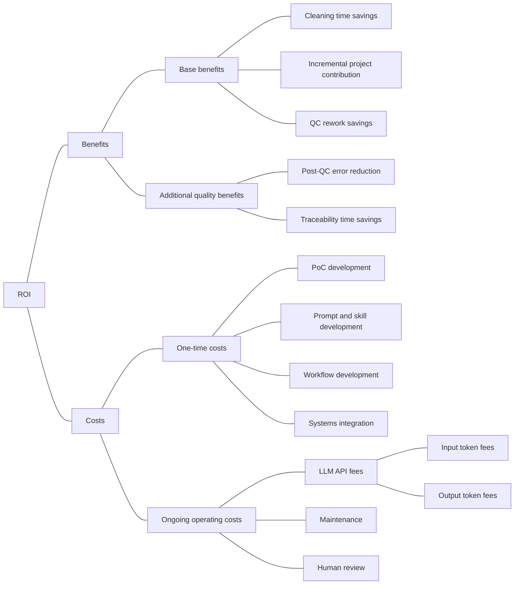

# ROI Analysis

## Returns and Costs



## First-year ROI formula

Use the same annual scope and a loaded hourly labor rate for each time-based item.

```text
Cleaning savings = datasets × (manual cleaning hours − AI-assisted cleaning hours)
                   × loaded hourly rate

Incremental project contribution = additional projects × net contribution per project

QC rework savings = datasets × QC rework rounds avoided per dataset
                    × hours per round × loaded hourly rate

Base benefits = cleaning savings + incremental project contribution + QC rework savings

One-time costs = PoC development + prompt and skill development
                 + workflow development + systems integration

Ongoing costs = input token fees + output token fees + maintenance + human review

Human review = datasets × routine AI review hours per dataset × loaded hourly rate

First-year ROI = (base benefits − one-time costs − ongoing costs)
                 ÷ (one-time costs + ongoing costs) × 100%
```

- **Cleaning and QC.** Exclude communication and routine QC from cleaning savings. Count avoided correction rounds under QC rework. Count routine review of AI output as an operating cost and exclude those same review minutes from AI-assisted cleaning time.
- **Additional projects.** Confirm incremental volume with Clarisa and estimate net contribution from comparable work after incremental delivery costs. Allocate released capacity either to cleaning savings or to incremental projects when the same hours enable both.
- **Development.** Allocate developer time once across prototype implementation, prompt and skill design, and workflow development. Estimate systems integration separately using relevant industry research and papers.
- **Operations.** For each API call, calculate input and output fees as tokens divided by one million times the applicable price per million, then sum across calls and retries. Use provider examples for comparable tasks to plan usage and agent logs to verify it. Estimate maintenance and human review from reference sources and confirm review effort with Clarisa.

## Additional quality benefits

Measure these separately in a real project. Add them to benefits once valued and checked for overlap.

| Category | Calculation |
| --- | --- |
| Post-QC error reduction | Annual projects × (manual residual errors per project − AI-assisted residual errors per project) × repair cost per error |
| Traceability time savings | Annual projects × (manual document preparation hours − AI-assisted document preparation hours) × loaded hourly rate |

Confirm manual document preparation time with Clarisa. Use zero manual preparation time for the agent's downloadable decision and results documents as a pilot assumption, and measure any editing or review time separately. User-defined cleaning rules support consistency across analysts. Evaluate that effect through residual errors or rework so its value is counted once.

## Illustrative first-year estimate

This example reclassifies the planning inputs from the [validation report](data_cleaning_validation.md). It uses 1,000 datasets per year and a loaded rate of $60/hour. The original processing estimate was 40 manual minutes versus 18 AI-assisted minutes. For this illustration, the manual estimate includes five minutes of rework that are excluded from cleaning, and the AI-assisted estimate includes eight minutes of routine review that are moved to operating costs. The remaining ten AI-assisted minutes include setup and export, with any embedded rework left in that figure because the validation estimate did not separate it. The resulting comparison is 35 versus 10 minutes for the modeled cleaning component.

| First-year item | Assumption | Value |
| --- | --- | ---: |
| Cleaning time savings | 1,000 × (35 − 10) minutes × $1/minute | $25,000 |
| Incremental project contribution | Pending volume and margin estimates | $0 modeled |
| QC rework savings | Pending separate round and duration measurements | $0 modeled |
| **Base benefits** | | **$25,000** |
| One-time development and integration | Prior illustrative budget, pending category-level estimates | $12,000 |
| LLM API fees | $0.50 per dataset, including retries | $500 |
| Maintenance | Prior illustrative annual budget | $6,000 |
| Human review | 1,000 × 8 minutes × $1/minute | $8,000 |
| **Total first-year costs** | | **$26,500** |
| **Net capacity benefit** | $25,000 − $26,500 | **−$1,500** |
| **First-year base ROI** | −$1,500 ÷ $26,500 | **−5.7%** |

The modeled shortfall is **$1,500** at 1,000 datasets, equivalent to **1.5 minutes of avoided QC rework per dataset** at the assumed labor rate, or $1,500 in distinct incremental project contribution. Holding per-dataset inputs constant with both benefits still set to zero, break-even requires **1,091 datasets per year** ($18,000 fixed costs ÷ $16.50 net capacity contribution per dataset, rounded up).

These are planning estimates of capacity value. Actual labor, token usage, project contribution and realized cash savings remain to be measured. The earlier 56.8% estimate used a broader labor savings scope and did not carry routine AI review as a separate operating cost.
