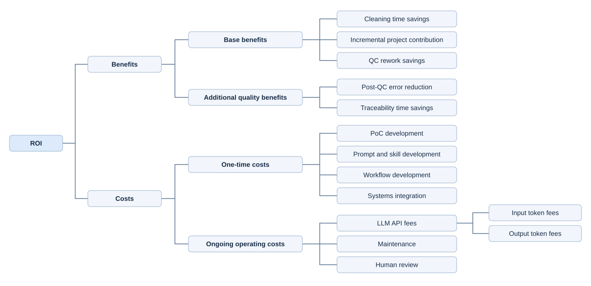

# ROI Analysis

## Returns and Costs



## First-year ROI formula

Use the same annual scope and a loaded hourly labor rate for each time-based item.

```text
Cleaning savings = datasets × (manual cleaning hours − AI-assisted cleaning hours)
                   × loaded hourly rate

Incremental project contribution = additional projects × net contribution per project

QC rework savings = datasets × QC rework rounds avoided per dataset
                    × hours per round × loaded hourly rate

Base benefits = cleaning savings + incremental project contribution + QC rework savings

One-time costs = PoC development + prompt and skill development
                 + workflow development + systems integration

Ongoing costs = input token fees + output token fees + maintenance + human review

Human review = datasets × routine AI review hours per dataset × loaded hourly rate

First-year ROI = (base benefits − one-time costs − ongoing costs)
                 ÷ (one-time costs + ongoing costs) × 100%
```

**PS. Additional quality benefits.** In a real project, estimate post-QC error savings as errors avoided × repair cost and traceability savings as manual document preparation time saved × labor rate. Confirm preparation time with Clarisa. Use residual errors or rework to measure the effect of shared cleaning rules, and count each benefit once.

## Illustrative first-year estimate
### Assumptions
**Assumption1:** Take the salary of a Statistical Programmer with 3 years of experience in the healthcare industry as the estimate, whose **hourly pay rate is $67**. Glassdoor reported in 2026(https://www.glassdoor.com/Salaries/statistical-programmer-salary-SRCH_KO0,22.htm). 

**Assumption2:** The amount of time spent on a dataset totally depends on the number of columns. That means, the amount of time on dealing with a dataset with 500 rows equals the time on 50k rows.

**Assumption3:** 

**Assumption4:** 


This example reclassifies the planning inputs from the [validation report](data_cleaning_validation.md). It uses 1,000 datasets per year and a loaded rate of $60/hour. The original processing estimate was 40 manual minutes versus 18 AI-assisted minutes. For this illustration, the manual estimate includes five minutes of rework that are excluded from cleaning, and the AI-assisted estimate includes eight minutes of routine review that are moved to operating costs. The remaining ten AI-assisted minutes include setup and export, with any embedded rework left in that figure because the validation estimate did not separate it. The resulting comparison is 35 versus 10 minutes for the modeled cleaning component.

| First-year item | Assumption | Value |
| --- | --- | ---: |
| Cleaning time savings | 1,000 × (35 − 10) minutes × $1/minute | $25,000 |
| Incremental project contribution | Pending volume and margin estimates | $0 modeled |
| QC rework savings | Pending separate round and duration measurements | $0 modeled |
| **Base benefits** | | **$25,000** |
| One-time development and integration | Prior illustrative budget, pending category-level estimates | $12,000 |
| LLM API fees | $0.50 per dataset, including retries | $500 |
| Maintenance | Prior illustrative annual budget | $6,000 |
| Human review | 1,000 × 8 minutes × $1/minute | $8,000 |
| **Total first-year costs** | | **$26,500** |
| **Net capacity benefit** | $25,000 − $26,500 | **−$1,500** |
| **First-year base ROI** | −$1,500 ÷ $26,500 | **−5.7%** |

The modeled shortfall is **$1,500** at 1,000 datasets, equivalent to **1.5 minutes of avoided QC rework per dataset** at the assumed labor rate, or $1,500 in distinct incremental project contribution. Holding per-dataset inputs constant with both benefits still set to zero, break-even requires **1,091 datasets per year** ($18,000 fixed costs ÷ $16.50 net capacity contribution per dataset, rounded up).

These are planning estimates of capacity value. Actual labor, token usage, project contribution and realized cash savings remain to be measured. The earlier 56.8% estimate used a broader labor savings scope and did not carry routine AI review as a separate operating cost.
