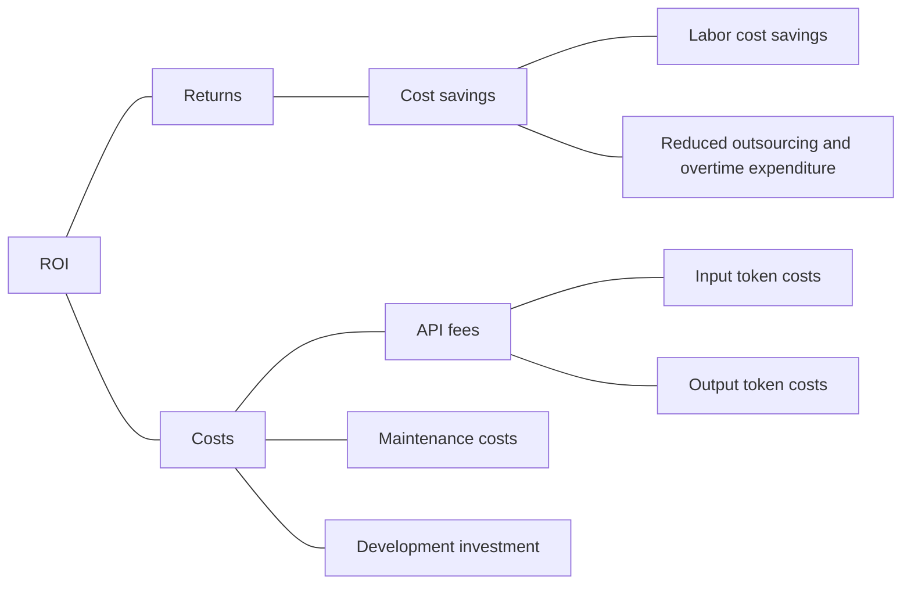

# ROI Analysis

## Returns and Costs



## Definitions and Accounting Boundaries

- **Labor cost savings:** Manual-workflow labor cost minus AI-assisted-workflow labor cost. Include input preparation, operation, correction, human review, and failed-task recovery on the AI-assisted side.
- **Reduced outsourcing and overtime expenditure:** Actual reductions in these expenses. Do not add them again if they are already included in labor cost savings.
- **API fees:** Input and output token charges are components of API fees, not additional costs to be counted a second time. Include other applicable API charges only when actually incurred.
- **Maintenance costs:** Recurring troubleshooting, prompt updates, and revalidation following model or workflow changes.
- **Development investment:** One-time prototype development, initial validation, deployment, and training.

Saved employee time can be expressed as capacity value. It becomes cash savings only when expenditure actually falls. Report capacity value and realized cash savings separately; do not count the same benefit twice.

## ROI formula

For a stated period, value the labor saved and subtract the incremental cost of the AI workflow:

```text
Labor capacity value = annual datasets × (manual minutes − AI-assisted minutes)
                       ÷ 60 × loaded hourly labor rate

Total benefit = labor capacity value + incremental outsourcing/overtime savings
                (only if those savings are not already counted)

AI cost = API charges + maintenance + development investment allocated to the period
ROI = (total benefit − AI cost) ÷ AI cost × 100%

Token charges = (input tokens ÷ 1,000,000 × input price per million)
              + (output tokens ÷ 1,000,000 × output price per million)
```

Sum token charges over all calls, including retries and review rounds, using the applicable rate for each call. In the example below, a per-dataset budget stands in for measured API charges. Do not add a separate token-cost estimate to that budget.

## Illustrative first-year estimate

The [validation report](data_cleaning_validation.md) estimates 70 manual minutes and 41 AI-assisted minutes per approximately 500-row dataset. This includes processing, communication, and independent QC. The difference is **29 minutes per dataset**, or **41.4% less active labor** under the base assumptions. These timings are planning estimates. The offline validation measured software execution time separately and did not measure real operator time or live model usage.

| Assumption | Base case |
| --- | ---: |
| Datasets per year | 1,000 |
| Loaded analyst rate | $60/hour |
| API budget, including retries | $0.50/dataset |
| Annual maintenance and revalidation | $6,000 |
| Development, initial validation, deployment and training | $12,000, fully charged in year one |
| Incremental outsourcing or overtime savings | $0 assumed |

Volume, wage and costs are illustrative USD planning inputs. The API budget is an assumption and should be replaced with actual token usage and billed rates. Maintenance excludes routine per-dataset review and QC, which are already in the AI-assisted labor estimate.

| First-year calculation | Amount |
| --- | ---: |
| Labor capacity value: 1,000 × 29/60 × $60 | $29,000 |
| AI cost: $500 API + $6,000 maintenance + $12,000 development | $18,500 |
| Net capacity benefit | **$10,500** |
| **First-year capacity ROI** | **56.8%** |
| Manual labor cost vs. AI-assisted labor plus AI cost | $70,000 vs. $59,500 |
| **Reduction versus manual baseline cost, after AI costs** | **15.0%** |

The 56.8% is the incremental return on AI investment. The 15.0% answers the separate question of how much the modeled total workflow cost falls versus manual cleaning. No standalone manual ROI was established, so there is no basis for a percentage-point ROI increase. The base case values about 483 hours of released capacity. Realized cash ROI is unmeasured and depends on documented reductions in spending or other monetized benefits.

## Sensitivity and break-even

Hold volume, wage and AI costs constant and substitute the paired time estimates from validation.

| Validation scenario | Manual / AI-assisted minutes | Saved minutes | Annual capacity value | First-year ROI |
| --- | ---: | ---: | ---: | ---: |
| Low effort | 42 / 25 | 17 | $17,000 | −8.1% |
| Base | 70 / 41 | 29 | $29,000 | 56.8% |
| High effort | 120 / 85 | 35 | $35,000 | 89.2% |

These are planning scenarios, not statistical intervals. With 29 minutes saved at $60/hour, each dataset generates $29 in capacity value and incurs $0.50 in API cost. Covering $18,000 of fixed first-year cost requires **632 datasets per year**. At 1,000 datasets, break-even requires **18.5 minutes saved per dataset**.

Replace the assumed inputs with paired manual and AI-assisted time logs, actual token charges, maintenance records, and observed annual volume. Check that the workflows meet the same independent QC standard before treating the estimated capacity gains as comparable.
